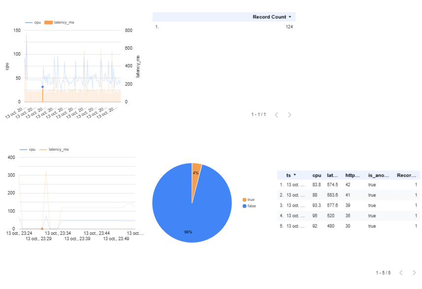

# CloudSentinel AI

An end-to-end MLOps and Cloud Engineering project on Google Cloud: anomaly detection on infrastructure metrics (CPU, memory, latency, HTTP errors), served through a containerised API, fed by an event-driven pipeline, stored in a data warehouse and visualised in a dashboard.

> **Scope note:** this is a technical demonstration built on **synthetic data**. It shows how to build, deploy, automate and monitor an ML application on GCP. It is not a production security tool and does not claim to detect real attacks.



## What it does

1. Generates synthetic server metrics (about 3% injected incidents of varying severity).
2. Trains an **Isolation Forest** (unsupervised) and evaluates it on a held-out split.
3. Serves the model through a **FastAPI** service (`/health`, `/predict`, `/pubsub`).
4. Receives metrics through **Pub/Sub**, scores them, and writes each prediction to **BigQuery**.
5. Displays the results in a **Looker Studio** dashboard.
6. Reproduces training as a **Vertex AI custom job** and versions the model in the **Model Registry**.
7. Describes part of the infrastructure with **Terraform**.
8. Demonstrates the same API on **GKE Autopilot** (Kubernetes) with Workload Identity.

## Architecture

```
generate.py -> data.csv -> train.py -> isolation_forest.joblib
                                              |
                                  api/main.py + Dockerfile
                                              |
              Cloud Build -> Artifact Registry -> Cloud Run (public API)
                                              ^
Simulator / Cloud Scheduler -> Pub/Sub --push--> /pubsub
                                              |
                      +-----------------------+----------------------+
                 Cloud Logging                                   BigQuery
              (+ log-based metric)                                   |
                                                              Looker Studio

Vertex AI custom job -> model.joblib (Cloud Storage) -> Model Registry
GKE Autopilot: Deployment (2 replicas) + LoadBalancer Service (same image)
Terraform: bucket, BigQuery dataset and table, Pub/Sub topic
```

## Google Cloud services used

| Area | Services |
|---|---|
| Compute and serving | Cloud Run, GKE Autopilot |
| Build and images | Cloud Build, Artifact Registry |
| Data | Cloud Storage, BigQuery |
| Messaging and scheduling | Pub/Sub, Cloud Scheduler |
| ML | Vertex AI (custom training job, Model Registry) |
| Observability | Cloud Logging (log-based metric `anomaly_count`) |
| Visualisation | Looker Studio |
| Infrastructure as Code | Terraform |
| Security | IAM, Workload Identity |

## Model results

Evaluated on a stratified 30% hold-out set (1,500 samples, 45 anomalies), synthetic data:

| Class | Precision | Recall | F1 |
|---|---|---|---|
| normal | 1.00 | 1.00 | 1.00 |
| anomaly | 0.91 | 0.91 | 0.91 |

Accuracy: 0.99. The same code, data and random seed produce identical results locally and on Vertex AI, which confirms the training is reproducible.

The first version of the data generator produced anomalies that were too obvious (perfect scores). Anomaly severity was then randomised so the results reflect a more realistic detection problem. Because the data is synthetic, these numbers say nothing about performance on real infrastructure.

## Repository structure

```
cloudsentinel-ai/
├── api/main.py            # FastAPI service
├── src/
│   ├── data/generate.py   # synthetic metrics
│   ├── models/train.py    # Isolation Forest training and evaluation
│   ├── simulator/publish.py  # publishes random metrics to Pub/Sub
│   └── vertex/            # Vertex AI training container (task.py, Dockerfile, job.yaml)
├── terraform/main.tf      # bucket, dataset, table, topic
├── k8s/                   # Deployment and Service manifests
├── docs/                  # screenshots
├── models/                # trained model
├── Dockerfile
└── requirements.txt
```

## API

| Route | Description |
|---|---|
| `GET /health` | Liveness check |
| `POST /predict` | Scores one set of metrics |
| `POST /pubsub` | Receives Pub/Sub push messages (base64-encoded JSON) |

Example:

```bash
curl -X POST "$URL/predict" -H "Content-Type: application/json" \
  -d '{"cpu": 92, "memory": 85, "latency_ms": 480, "http_errors": 30}'
# {"is_anomaly": true, "anomaly_score": -0.2346}
```

A negative score means anomalous, a positive score means normal. Each prediction is logged and inserted into the BigQuery table `cloudsentinel.predictions`.

## Reproduce

Prerequisites: a GCP project with billing enabled, `gcloud`, Python 3.12.

```bash
# 1. Data and model (local)
python -m venv .venv && source .venv/bin/activate
pip install pandas numpy scikit-learn joblib
python src/data/generate.py
python src/models/train.py

# 2. Storage and warehouse
gcloud storage buckets create gs://$PROJECT-artifacts --location=europe-west9
gcloud storage cp models/isolation_forest.joblib gs://$PROJECT-artifacts/models/
gcloud storage cp data.csv gs://$PROJECT-artifacts/data/
bq --location=europe-west9 mk -d cloudsentinel
bq mk -t cloudsentinel.predictions \
  ts:TIMESTAMP,cpu:FLOAT,memory:FLOAT,latency_ms:FLOAT,http_errors:FLOAT,is_anomaly:BOOLEAN,anomaly_score:FLOAT

# 3. Deploy the API (build happens on Cloud Build)
gcloud run deploy cloudsentinel-api --source . --region europe-west9 \
  --allow-unauthenticated --min-instances 0 --max-instances 2 --memory 512Mi

# 4. Event pipeline
gcloud pubsub topics create metrics-stream
gcloud pubsub subscriptions create metrics-to-api --topic metrics-stream \
  --push-endpoint="$URL/pubsub"
python src/simulator/publish.py 100

# 5. Check results
bq query --use_legacy_sql=false 'SELECT * FROM cloudsentinel.predictions ORDER BY ts DESC LIMIT 5'
```

Terraform (existing resources are imported, then managed):

```bash
cd terraform && terraform init && terraform plan
```

## Vertex AI

Training runs as a custom job using a purpose-built container with the same pinned library versions as the API (a model saved with one scikit-learn version may not load with another). The trained model is stored in Cloud Storage and registered in the Model Registry.

The model is registered but **not deployed to an endpoint**. The Vertex prediction format (`{"instances": [...]}`) differs from this API's input format, so deployment would require an adapter route.

## Kubernetes

The same container image was deployed on GKE Autopilot: a Deployment with 2 replicas and a LoadBalancer Service. The pods write to BigQuery through **Workload Identity** with the `roles/bigquery.dataEditor` role, following least privilege. A first attempt using the default node identity could answer predictions but could not insert into BigQuery; binding a dedicated Kubernetes service account fixed it.

The cluster was deleted after the demonstration, so it is not a long-running deployment.

## Cost and resource management

- Cloud Run runs with `min-instances 0`, so nothing runs without traffic.
- Cloud Scheduler jobs are paused when not in use.
- No Vertex AI endpoint was created.
- The GKE cluster was deleted after testing, and no load balancer was left behind.
- A budget with alert thresholds was configured on the project.

## Limitations

- All data is synthetic; the model is simple by design.
- Terraform manages only the bucket, the BigQuery dataset and table, and the Pub/Sub topic. Cloud Run, the Pub/Sub subscription, Scheduler jobs, Artifact Registry and the GKE cluster were created with the CLI.
- No CI/CD pipeline (for example GitHub Actions); tests are not automated.
- A log-based metric (`anomaly_count`) exists, but no alerting policy was created.
- The Cloud Run API is public and unauthenticated, which is acceptable for a demo only.
- Kubernetes manifests are minimal: no readiness probes, autoscaling, Ingress or HTTPS.
- Vertex AI model registered without an endpoint.
- The Terraform state is kept locally and is not in a remote backend.

## Possible improvements

- Add GitHub Actions (tests, image build, deployment).
- Add a Cloud Monitoring alerting policy on `anomaly_count`.
- Bring Cloud Run, the subscription and the Scheduler jobs under Terraform, with a remote state backend.
- Add a Vertex-compatible prediction route and deploy to a temporary endpoint.
- Authenticate Pub/Sub push and restrict API access.
- Add unit tests with pytest.

## Tech stack

Python, pandas, scikit-learn, FastAPI, Docker, Terraform, Kubernetes, Google Cloud (Cloud Run, GKE, BigQuery, Pub/Sub, Vertex AI, Cloud Storage, Cloud Build, Artifact Registry, Cloud Scheduler, Cloud Logging), Looker Studio.
